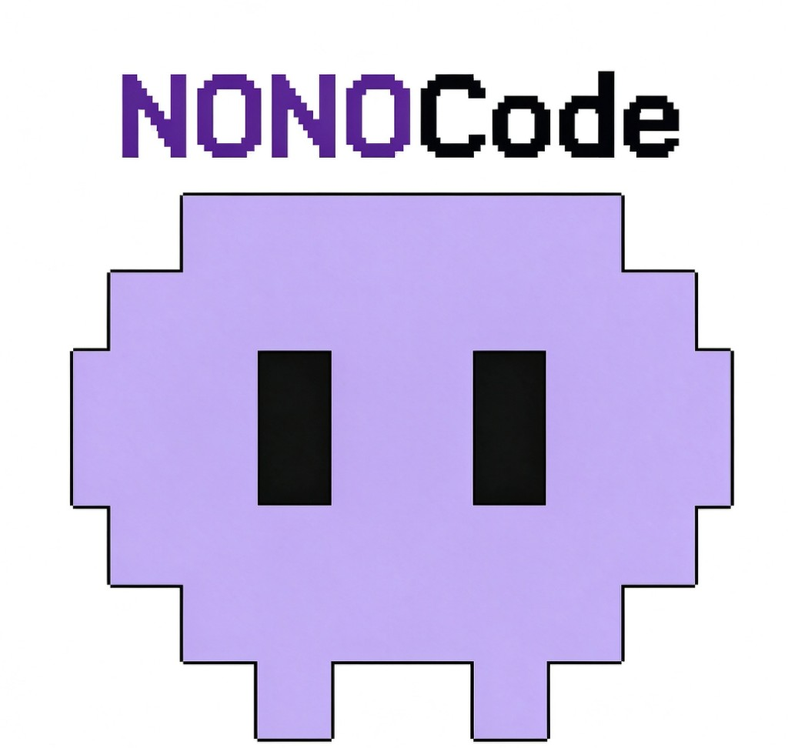
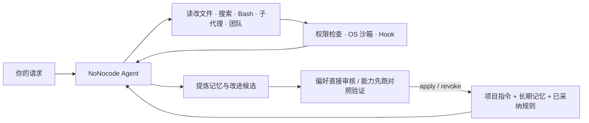

<p align="center">
  
</p>

<p align="center">
  <b>跑在终端里的个人 AI 助手。</b><br>
  写代码、查资料、做规划、整理文件，把你的工作方式留在项目里。
</p>

<p align="center">
  <a href="#开始使用">开始使用</a> ·
  <a href="#怎么工作">怎么工作</a> ·
  <a href="#记忆与进化">记忆与进化</a> ·
  <a href="#常用命令">常用命令</a> ·
  <a href="PERSONAL_ASSISTANT.md">完整说明</a>
</p>

NoNocode 把日常对话沉淀成两类可以复查的东西：长期记忆，以及经过你审核的工作规则。表达偏好由你决定是否采纳；涉及方法或效果的能力主张，必须先在固定任务上跑过对照检查，才会进入后续对话。改进记在规则和记忆里，不训练模型权重，也不自己改核心程序。

## 为什么做它

| 问题 | NoNocode 的做法 |
|---|---|
| 新开会话就忘了你的习惯 | 用户偏好跟人走，项目事实跟仓库走。下次打开仍在，当前请求始终优先。 |
| 记忆越攒越乱，不知道哪句算数 | 自动候选必须能对上你的原话。系统提醒、助手自称成功、普通致谢不会变成规则。 |
| 改了提示词，不知道是真变好还是碰巧 | 能力候选要在冻结的输入和固定检查上跟当前规则对照试跑，稳定变好且无退步才允许采纳。 |
| 代理权限太宽，跑命令不放心 | 默认只放行读取，写文件和执行命令先确认；提供路径限制、Git worktree 隔离和可选 OS 沙箱。 |

## 怎么工作



### 执行任务

- **文件与命令。** 内置 `ReadFile`、`WriteFile`、`EditFile`、`Glob`、`Grep`、`Bash`，多轮调用直到任务做完。上下文接近上限时自动摘要，并尽量保留最近读过的文件和正在使用的技能。
- **子代理与团队。** 只读探索（`Explore`）、方案规划（`Plan`）和通用执行交给独立子代理。复杂任务可以建团队，用邮箱消息和共享任务板协作；队友可跑在当前进程、tmux 或 iTerm2 窗格里。
- **扩展能力。** 按需加载 `.nonocode/skills/` 与 `~/.nonocode/skills/` 里的技能包；MCP 工具延迟检索，不在开局塞满上下文；会话、轮次、工具调用和文件变更都可挂 Hook。
- **三种入口。** 终端交互界面、`nonocode -p` 单次执行（支持 `--output-format stream-json`），以及 `--remote` 浏览器界面。

### 记忆与进化

自动记忆和进化账本分开存放、互不覆盖：

- **自动记忆**存成带索引的 Markdown。用户与反馈记忆在 `~/.nonocode/memory/`，项目与参考记忆在 `.nonocode/memory/`。后台整理只读写记忆文件和只读会话记录，不执行 shell。
- **进化候选**存在 `.nonocode/evolution/`，分 `preference`（语言、篇幅、结构）和 `capability`（步骤、方法、效果主张）。每条候选保留原话证据和成功／失败反馈，反馈次数不会触发自动采纳，也不会自动改写已采纳条文。

能力候选的完整闭环：

```text
/evolve capability 汇总带符号金额时，将负数与正数一起计入总和，避免过滤负数。
/evolve task examples/evolution/signed-ledger.task.json
/evolve task examples/evolution/positive-ledger.task.json
/evolve verify <候选完整ID> signed-ledger positive-ledger
/evolve report <候选完整ID>
/evolve apply <候选完整ID>
```

试跑在独立临时目录里交替执行当前规则与候选规则，期望答案不提供给试跑助手，由固定 Python 检查器核对产物（`file_exists`、`text_contains`、`json_equals`、`csv_rows`）。只有 `passed` 才能采纳；之后随时可以 `/evolve revoke`。

## 0.3.0 新增

SQLite 会话和任务存储、历史搜索、可编辑的记忆管理，以及网页“历史 / 任务中心 / 记忆”面板。数据库默认位于本机 `~/.local/share/nonocode/nonocode.db`，旧会话首次启动自动导入。升级前请先结束旧实例并退出。

```bash
nonocode --history "关键词"  # 离线搜索
nonocode --runs             # 持久化任务记录
nonocode --doctor           # 本机诊断，不显示密钥
```

终端可用 `/history`、`/runs`、`/storage`；网页可恢复和导出会话、查看工具步骤、编辑记忆。详见 [0.3.0 升级与数据说明](RELEASE_NOTES_0.3.md)。

## 开始使用

需要 Python 3.11 或更新版本。

```bash
python -m pip install -e .
cp .nonocode/config.yaml.example .nonocode/config.yaml
```

支持 `anthropic`、`openai`、`openai-compat` 三种协议。下面是 `.nonocode/config.yaml` 的最小示例（以 DeepSeek 的 Anthropic 兼容接口为例）：

```yaml
providers:
  - name: deepseek
    protocol: anthropic
    base_url: https://api.deepseek.com/anthropic
    model: deepseek-flash
    api_key: ""
    thinking: false
    max_output_tokens: 4096

permission_mode: default
mcp_servers: []
```

把 `api_key` 留空，从环境变量提供密钥（`anthropic` 读 `ANTHROPIC_API_KEY`，`openai` 与 `openai-compat` 读 `OPENAI_API_KEY`）：

```bash
read -r -s -p "ANTHROPIC_API_KEY: " ANTHROPIC_API_KEY
printf '\n'
export ANTHROPIC_API_KEY
nonocode
```

配置按 `~/.nonocode/config.yaml`、当前目录 `.nonocode/config.yaml`、`.nonocode/config.local.yaml` 合并，后面的 `providers` 覆盖前面的列表。本地配置、会话、日志和进化记录已由 `.gitignore` 排除，不会随仓库提交。

单次运行或启动浏览器界面：

```bash
nonocode -p "请只回复 OK"
nonocode -p "列出当前目录的 Python 包" --output-format stream-json
nonocode --remote
```

## 常用命令

| 命令 | 作用 |
|---|---|
| `/help`、`/status` | 查看命令说明、当前模型与上下文状态 |
| `/plan`、`/permission`、`/sandbox` | 切换规划模式、权限策略与操作系统沙箱 |
| `/session`、`/compact`、`/clear`、`/rewind` | 管理会话、压缩上下文、清空对话或回退文件检查点 |
| `/memory list\|search\|show\|add\|update\|forget` | 搜索、查看、编辑和删除自动记忆 |
| `/history`、`/runs`、`/storage` | 历史搜索、任务中心与数据库备份 |
| `/evolve feedback\|capability\|verify\|apply\|revoke` | 记录候选、跑对照验证、采纳或撤回规则 |
| `/skill`、`/mcp`、`/worktree`、`/tasks`、`/trace` | 管理技能、MCP 服务、Git worktree、后台任务与子代理调用树 |

## 目录结构

```text
nonocode/
├── agent.py / app.py / remote.py   # Agent 主循环、Textual TUI、浏览器服务
├── client.py / serialization.py    # Anthropic / OpenAI / 兼容协议客户端
├── tools/                          # 文件、Bash、搜索、子代理、团队、任务、Skill 工具
├── agents/ & teams/                # 子代理定义、后台任务、队友通信与多后端启动
├── memory/                         # 指令加载、自动记忆、相关召回、会话与整理
├── storage/                        # SQLite 会话、主执行记录、全文搜索与备份
├── evolution/                      # 候选账本、双臂对照验证与无模型演示
├── permissions/ & sandbox/         # 权限模式、危险命令检测、bubblewrap / Seatbelt
├── skills/ & mcp/ & hooks/         # 技能加载、MCP 客户端、生命周期 Hook
└── worktree/ & commands/           # Git worktree 隔离与斜杠命令
```

## 开发与验证

```bash
python -m pytest
```

不连接模型服务、直接跑通能力验证与采纳撤回流水线：

```bash
python -m nonocode.evolution.demo --output /tmp/nonocode-verified-demo
```

更多细节见 [`PERSONAL_ASSISTANT.md`](PERSONAL_ASSISTANT.md) 与项目指令文件 [`NONOCODE.md`](NONOCODE.md)。

## 许可

尚未指定开源许可证。使用或再分发前请先与维护者确认。
